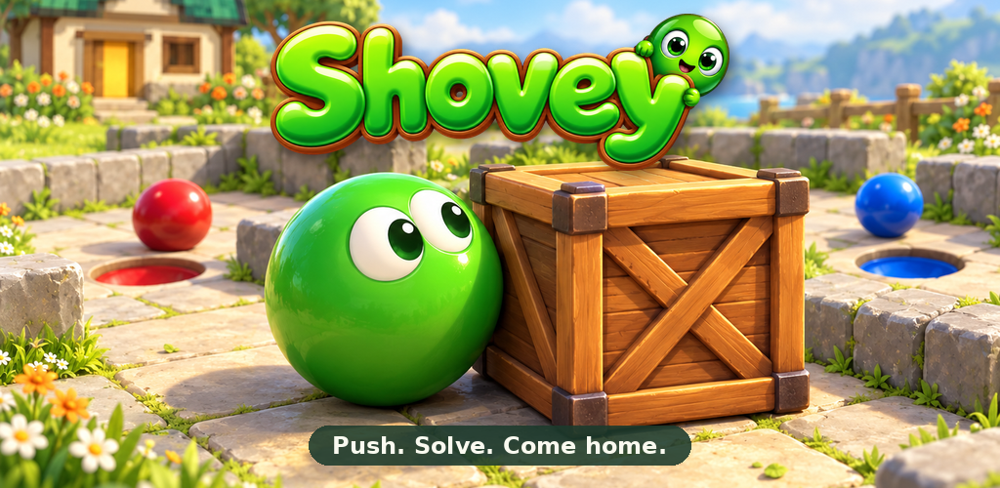
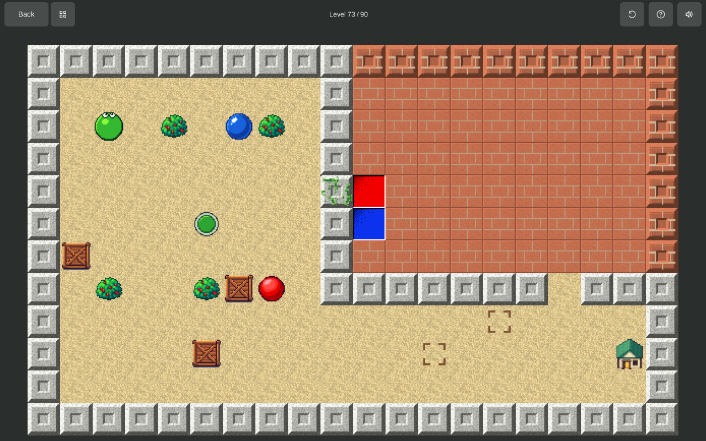
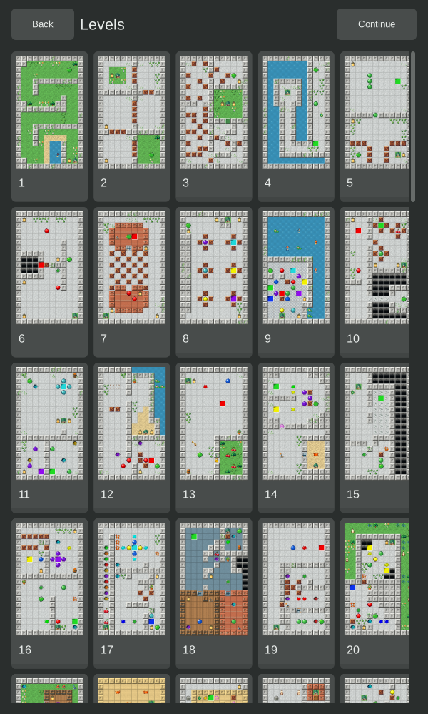
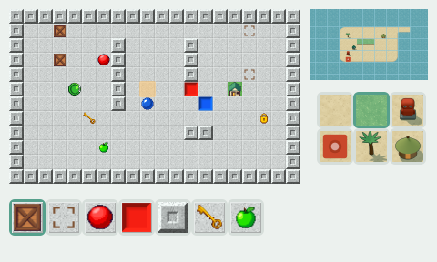

<p align="center">
  
</p>

# Shovey

**Push. Solve. Come home.**

A colorful puzzle adventure about finding a path home. Push balls into matching
pits, move crates onto their marks and untangle the board one move at a time.

[Play online](https://shovey.waozi.xyz/)
· [Play on itch.io](https://waozi.itch.io/shovey)
· [Download for Android, Linux and Windows](https://github.com/waozixyz/shovey/releases/latest)
· [What's new](src/CHANGELOG.md)

## Find your way home

- **175 Classic puzzles:** discover a route through gardens, sand yards and winding rooms.
- **A world that moves:** portals, levers, gates and wandering animals change the path.
- **Play your way:** swipe, use the movement pad or a keyboard, in portrait or landscape.
- **Keep your progress:** revisit unlocked puzzles and try a fresh approach whenever you like.
- **Make something yours:** create and play your own boards in the integrated editor.



## A look inside

<p align="center">
  
  
</p>

Open **Shovey Editor** from its cover on the start screen. Start a new board or make your own
copy of a story level. Paint the ground and objects, undo a stroke, then press
**Play** to try it. Drafts save as you edit, and proven puzzles can be exported.

## Yours to play

Play locally without an account. Shovey is free and open source, with no ads or
analytics SDK. Optional account and node features are separate from local play.

Shovey also runs inside [Arcade](https://github.com/waozixyz/arcade) and
[Breeze](https://github.com/waozixyz/breeze).

Shovey Island is an optional paid expansion. Its compiled game is bundled with the standalone
player. Choose Buy to purchase it; verified owners can play without a separate
Island download. Browser collections without the included game use protected
package delivery.
The start of each signed-in session needs a connection to verify access. Once
verified, that session can keep playing offline. Cached packages are checked
against the public catalog's exact size and SHA-256 digest.

[F-Droid submission](https://gitlab.com/fdroid/fdroiddata/-/merge_requests/53911)
· [Report a problem](https://github.com/waozixyz/shovey/issues)

BSD 3-Clause. See [LICENSE](LICENSE).

## World map development

Reusable map tools live in `scripts/` and `tests/`. The generator uses Pillow,
NumPy and SciPy. Regenerate the tiles and native geometry from a source pair:

```sh
python3 scripts/tile_world_map.py --version 4
```

Road guides are stored in `scripts/world_map_roads.json`. Source paintings live
under `work/world-map-source/`; generated game tiles and scene metadata live
under `assets/shovey/world-map/`.

Run spacing validation, the map suite and the Linux player build:

```sh
python3 tests/world_map_spacing_test.py
build-queue -- make world-map-test player-linux
```

Run progression independently, or test Play, map selection and double-click
entry on a private Xvfb display after building the player:

```sh
build-queue -- sh tests/world_map_progression_test.sh
sh tests/world_map_selection_ui_test.sh
```

The UI runner defaults to the sibling `waozixyz/apps/breeze` checkout for its
test driver. Set `UI_DRIVER_SOURCE` or pass `--driver-source` to use another
location; `--binary` selects another built player. Generated logs, screenshots,
temporary files and private profiles remain under ignored `work/` directories.

## CrazyGames submission build

Run `make web-crazygames` to build the guest browser edition and write
`work/crazygames.zip`. The ZIP uses relative asset paths and keeps local saves;
it does not include the website's external loading fallback. Run
`make package-crazygames-test` to verify the packaging rules. This prepares a
local Basic Launch candidate; uploading and submitting it through the
[CrazyGames Developer Portal](https://developer.crazygames.com/) is a separate step.
