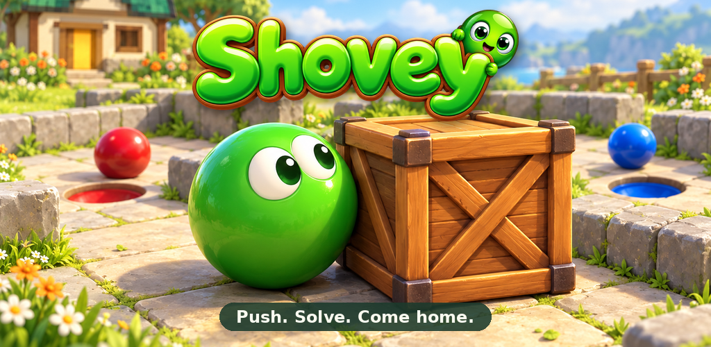

  

# Shovey

**Push. Solve. Come home.**

A colorful puzzle adventure about finding a path home. Push balls into matching
pits, move crates onto their marks and untangle the board one move at a time.

[Play online](https://shovey.waozi.xyz/)
· [Play on itch.io](https://waozi.itch.io/shovey)
· [Download for Android, Linux and Windows](https://github.com/waozixyz/shovey/releases/latest)
· [What's new](src/CHANGELOG.md)

## Find your way home

- **100 Classic puzzles:** discover a route through gardens, sand yards and winding rooms.
- **A world that moves:** portals, levers, gates and wandering animals change the path.
- **Play your way:** swipe, use the movement pad or a keyboard, in portrait or landscape.
- **Keep your progress:** revisit unlocked puzzles and try a fresh approach whenever you like.
- **Make something yours:** create and play your own boards in the integrated editor.

## A look inside

  
  

Open **Shovey Editor** from its cover on the start screen. Start a new board or make your own
copy of a story level. Paint the ground and objects, undo a stroke, then press
**Play** to try it. Drafts save as you edit, and proven puzzles can be exported.

## Yours to play

Play locally without an account. Shovey is free and open source, with no ads or
analytics SDK. Optional account and node features are separate from local play.

Shovey also runs inside [Arcade](https://github.com/waozixyz/arcade) and
[Inner Breeze](https://github.com/waozixyz/inbe).

[F-Droid submission (draft)](https://gitlab.com/fdroid/fdroiddata/-/merge_requests/53911)
· [Report a problem](https://github.com/waozixyz/shovey/issues)
· [Build and contribute](docs/development.md)

BSD 3-Clause. See [LICENSE](LICENSE).
