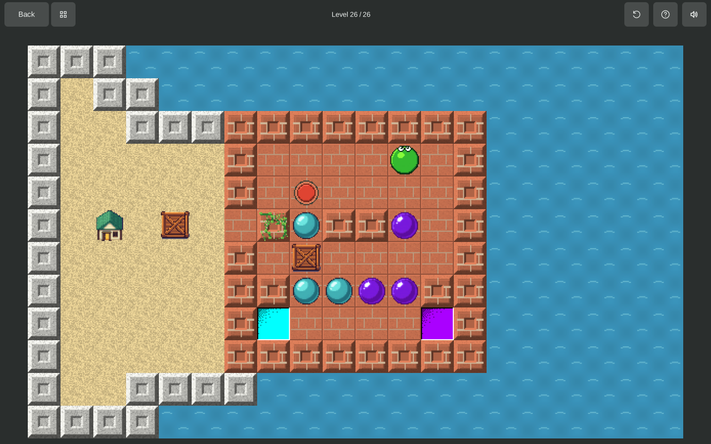
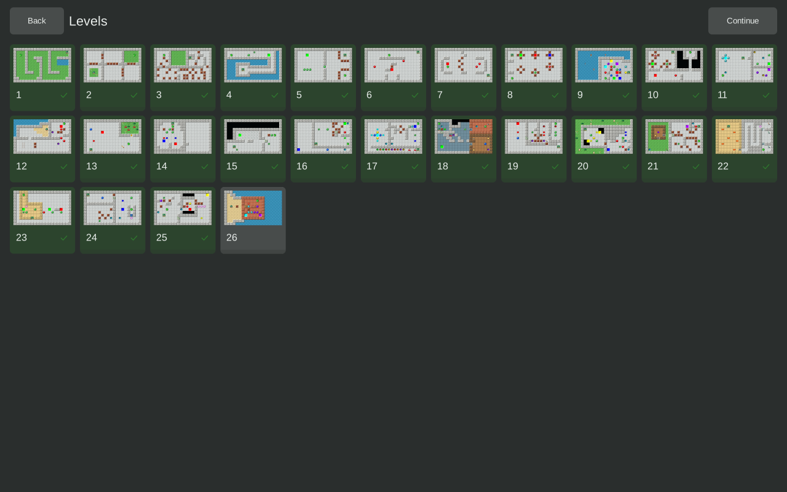
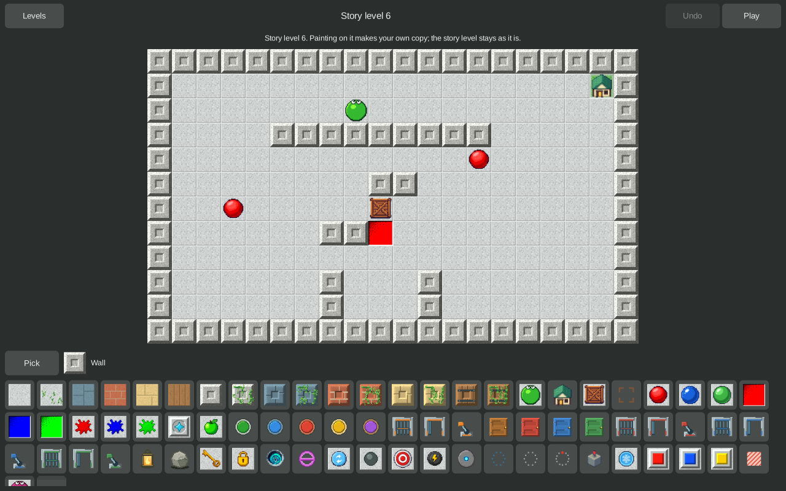
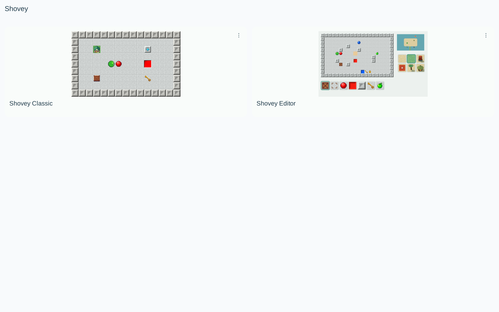

# Shovey

**Push. Solve. Come home.**

Shovey is a puzzle game about finding a path home. Push balls into matching
pits, move crates onto their marks, collect what you need and untangle the
board one move at a time.



## Play

- **26 Classic levels**, with a checked winning route for every published puzzle.
- **Touch and keyboard controls**, with portrait and landscape layouts.
- **Saved progress**, restart and a level chooser for revisiting unlocked puzzles.
- **An integrated level editor** for making and testing your own boards.

Colored portals, levers, gates, pressure buttons and mossy walls change the
route. Ducks, turtles and crabs wander across open ground; fish move through
water. Trees, boulders and lanterns block the way. An abyss ends a run with a
quick spinning fall.

Shovey runs as a standalone desktop and Android game, and inside
[Arcade](https://github.com/waozixyz/arcade) and
[Inner Breeze](https://github.com/waozixyz/inbe).
Use the arrow keys or swipe to move; the game bar has Restart, Levels, Help,
sound and Back controls.



## Make a puzzle

Open **Shovey Editor** from the game chooser. Start a new board or make your
own copy of a story level. Ground, objects and decoration are stored in separate
layers, so changing the floor does not require rebuilding every object.
Paint, undo a stroke, then press **Play** to test the board with the game's
actual rules. Drafts are saved as you edit.

The editor checks for a winning route while you build. Solving the board
yourself proves it too. Proven puzzles can be exported, and hosts with
collection sharing can publish them for friends or other players.



**Island editing is available.** The Island story campaign is still in development.

<details>
<summary>Game chooser</summary>



</details>

## Build and develop

Shovey uses [Ziran](https://github.com/ziranlang/ziran) and
[Kryon](https://github.com/kryonlabs/kryon). Run these commands from this repository:

```sh
make bundles    # Portable game and integrated-editor bundles
make web        # Browser build in build/web/
make test       # Replay stored solutions and check game assets
make editor     # Desktop developer editor
```

Run the developer editor with `build/private-editor/shovey-level-editor`.
It has separate Tiles and Objects palettes, Undo, Redo, Reset, engine-checked
GLM variations and background approval publishing when configured.

See [development notes](docs/development.md) for level files, native play,
imports, the developer workflow and artwork generation.

## License

BSD 3-Clause. See [LICENSE](LICENSE).
